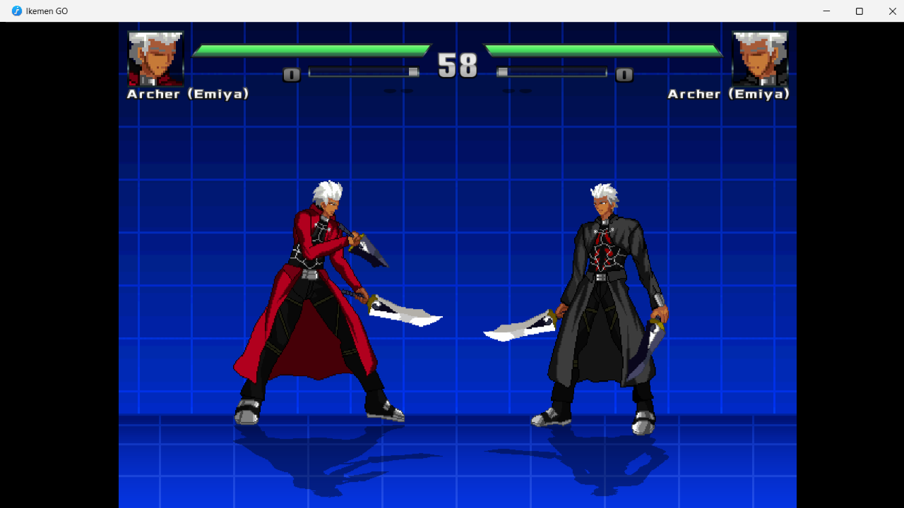
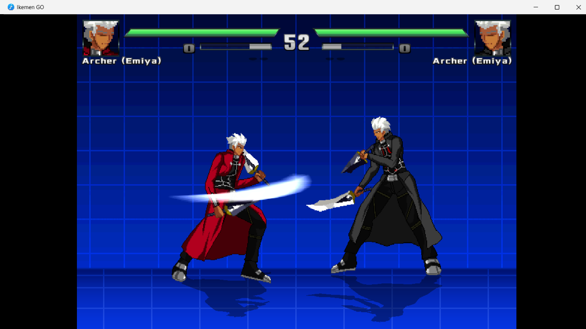
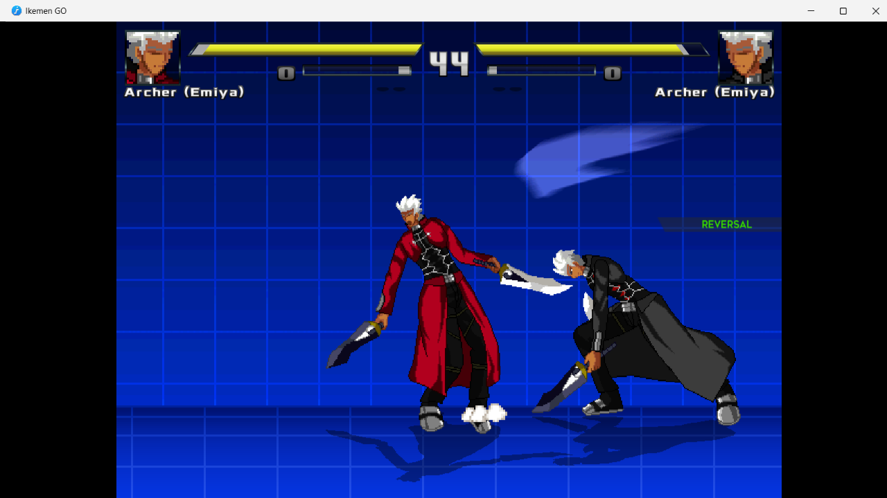

# KingOfFate (KOF)

A 2D fighting game project built on top of the **[IKEMEN GO](https://github.com/ikemen-engine/Ikemen-GO)** engine.

KingOfFate focuses on **game content, character design, combat rules, CPU AI, tooling and testing**
rather than re-implementing a fighting-game engine.

### 设计宗旨（2026-10-02 定版）

> **让每个人都能轻松放技能的格斗游戏。**

- **人人能放**：没有任何搓招。所有技能都是「方向 + 按钮」或「按钮 + 按钮」。
- **量大管饱**：招式多、量大。每个角色 12 个普通招式起、8 个以上气键技能。
- **反制为纲**：策略深度来自「用自己的一整套招式去反制对方可能放出的各种技能」，
  而不是来自把指令搓成连招。

**操作分层只有一条规则**：

```text
只用 A / S / Z / X   →  不耗气的普通招式（轻拳 / 重拳 / 轻脚 / 重脚）
带 C 或 D            →  消耗气槽的技能（C = 中型，D = 大型，C+D = 终极技）
```

完整设计见 **[`docs/game-design-charter.md`](docs/game-design-charter.md)（游戏设计总纲）**。
该文件是方向性文件，高于阶段计划与迭代记录。

---

## Status

**Current phase: `P6 — First Final-Art Character` — 🚧 IN PROGRESS (branch
`feature/p6-first-final-art-character`)**

P6 is the first character that stands on **final art** instead of KFM placeholder:
`game/chars/archer/` (Archer / EMIYA), built on the Zoner skeleton P4 validated, with the
sprite set coming from the MUGEN community and every source registered in
[`assets/LICENSE_MANIFEST.csv`](assets/LICENSE_MANIFEST.csv). It is playable now, with
temporarily simplified commands so the moves can be verified by hand. The art source is
being upgraded to a high-resolution pack before the phase is called done; the state of
that, and everything already finished, is in
[`docs/development_status.md`](docs/development_status.md).

P1 validated the character execution chain by measurement, P2 turned it into a cloneable
4-button template (`game/chars/_template/`), and P3 cloned that template into the project's
first independent, playable fighter: `game/chars/test_fighter_a/`. P4 then cloned the same
template into a **deliberately different** fighter — `game/chars/test_fighter_b/`, a Zoner
with a native projectile, a long-reach poke and two tiers of anti-air — proving the
architecture carries more than one fighting style. Both fighters are complete, playable and
validated in real matches; the engine baseline is still untouched.

P5 added the character **asset tooling** that P6 needs: read an SFF, export its sprites,
read and validate an animation table, and check whether a character directory is complete
enough to reach Runtime. Everything is read-only and dependency-free, and the tools found a
real defect in existing content on their first run.

**Starting fresh?** Read [`docs/HANDOFF.md`](docs/HANDOFF.md) first — it carries the background, the
current state, the tracker of what is still broken, and the list of mistakes this project has already
made (most of which produce no engine error at all).

Then [`docs/PROGRESS.md`](docs/PROGRESS.md) for the overview and the single task list,
[`docs/game-design-charter.md`](docs/game-design-charter.md) for the design (highest authority on
direction), and [`docs/GLOSSARY.md`](docs/GLOSSARY.md) to align vocabulary before discussing anything.

Phase history lives in [`docs/development_status.md`](docs/development_status.md) and
[`docs/P6-summary.md`](docs/P6-summary.md) (`P5`, `P4`, `P3`, `P2`, `P1` and `P0` summaries for the
earlier ones), the asset tools in [`docs/character_asset_tooling.md`](docs/character_asset_tooling.md),
how a character is built in [`docs/ikemen_character_architecture.md`](docs/ikemen_character_architecture.md),
per-phase reports in [`docs/phase_reports/`](docs/phase_reports/), and the engineering log of how the
project got here in [`docs/iterations/`](docs/iterations/).

---

## Archer — the first final-art character

`game/chars/archer/` (Archer / EMIYA, *Fate/stay night*) is the character that leaves placeholder art
behind: a high-resolution sprite set, four selectable palettes, twin blades, arrow projectiles, and a
Reality Marble ultimate.

| Standing off | Mid-slash | Reversal combo |
| --- | --- | --- |
|  |  |  |

Both sides are AI-controlled (level 8) in a mirror match on `stage0`. The frames are captured from the
real engine, not composed:

```powershell
pwsh -File tests/p1/capture_match.ps1 -P1 archer -P2 archer -Stage stage0 -Ai1 8 -Ai2 8 `
     -WarmupSec 6 -Shots 8 -ShotIntervalSec 2 -Prefix archer -OutDir docs\images\p6
```

---

## Engine & repository model

KingOfFate does **not** fork or copy the fighting engine into this repository. The engine is pinned as a
Git Submodule and must stay on the project's integration branch.

| Item | Value |
| --- | --- |
| Engine | IKEMEN GO |
| Engine baseline | `v1.0.0-rc.5` |
| Engine commit | `ba516193bba83f13f0b63ddce314d8719793931f` |
| Engine fork | `Blinkblade/Ikemen-GO` (`origin`) |
| Engine upstream | `ikemen-engine/Ikemen-GO` (`upstream`) |
| Integration branch | `kingoffate/rc5` |
| Submodule path | `engine/ikemen-go` |

The engine baseline is intentionally frozen. Do not auto-sync with upstream `develop`.

---

## Getting the source

Clone with submodules in one step:

```bash
git clone --recurse-submodules https://github.com/Blinkblade/KingOfFate.git
```

If you already cloned without submodules:

```bash
git submodule update --init --recursive
```

Verify the engine baseline is correct:

```bash
git submodule status
#  ba516193bba83f13f0b63ddce314d8719793931f engine/ikemen-go (v1.0.0-rc.5)
```

---

## Building

> Prerequisites and the exact dependency list come from the engine's own
> [`engine/ikemen-go/BUILDING.md`](engine/ikemen-go/BUILDING.md). That file is the source of truth for this
> pinned RC5 baseline — read it before changing any build step.

On Windows the toolchain is **MSYS2 / MINGW64** (Go, MinGW GCC, `pkg-config`, NASM, SDL2, libxmp, FFmpeg).

Build through the project entry point (works from any working directory):

```powershell
pwsh -File scripts/build_engine.ps1
```

On a machine that needs a proxy for large downloads (and where `proxy.golang.org` / the FFmpeg
sources are not directly reachable), pass it explicitly - nothing is hardcoded:

```powershell
pwsh -File scripts/build_engine.ps1 -BuildFfmpeg no -Proxy http://127.0.0.1:7897 -GoProxy https://goproxy.cn,direct
```

- `-BuildFfmpeg no` uses the MSYS2 FFmpeg development packages. This is the option documented in
  `engine/ikemen-go/BUILDING.md` under "Use system FFmpeg instead (optional)".
- `-Proxy` / `-GoProxy` default to `$env:HTTPS_PROXY` / `$env:GOPROXY` when set.

Or invoke the engine build script directly from an MSYS2 MINGW64 shell:

```bash
cd engine/ikemen-go
./build/build.sh Win64
```

The produced executable is:

```text
engine/ikemen-go/Ikemen_GO.exe
```

Build logs are written to `logs/build/<YYYYMMDD>/`.

---

## Running

```powershell
pwsh -File scripts/run_game.ps1
```

The run script locates the built `Ikemen_GO.exe`, checks the runtime assets, resolves the runtime
DLL search path, and launches the game. It never builds for you — if the executable is missing it
will tell you to run `scripts/build_engine.ps1` first.

Run `-CheckOnly` for a preflight check without launching:

```powershell
pwsh -File scripts/run_game.ps1 -CheckOnly
```

Full launch documentation — script parameters, direct-executable launch, the engine's command line
arguments and troubleshooting — is in [`docs/running.md`](docs/running.md).

Once the game is running: menu navigation, default keyboard/gamepad bindings, how to rebind keys
and the full move list (with the files that define it) are documented in
[`docs/controls.md`](docs/controls.md).

---

## Testing

```powershell
pwsh -File scripts/test.ps1
```

`scripts/test.ps1` runs the project's test suites and returns:

```text
0   = PASS
!=0 = FAIL   (the failing check and the reason are printed)
```

| Suite | What it covers |
| --- | --- |
| `smoke` (`tests/smoke/`) | the engine submodule and its pinned baseline, the runtime directories, the build artifact, the basic files needed to run a match, and the project scaffolding |
| `tools` (`tests/tools/`) | the P5 character asset tools: every command, every exit code, the fixture set, and a pixel-accurate check of exported sprites |

Options:

```powershell
pwsh -File scripts/test.ps1 -Suite smoke     # only the project invariants
pwsh -File scripts/test.ps1 -Suite tools     # only the asset tools
pwsh -File scripts/test.ps1 -Full            # also export all 282 sprites and render a montage
pwsh -File scripts/test.ps1 -RuntimeTest     # smoke + a real engine launch check
```

The asset tools need Python 3.8+ and **no third-party packages**; see
[`docs/character_asset_tooling.md`](docs/character_asset_tooling.md).

---

## Repository layout

```text
KingOfFate/
├── .github/              GitHub collaboration config (PR template)
├── engine/
│   └── ikemen-go/        IKEMEN GO submodule (pinned, do not repoint)
├── game/
│   ├── chars/            Characters
│   ├── stages/           Stages
│   ├── data/             Game system data / screenpack defs
│   ├── font/             Fonts
│   ├── sound/            Sound & music
│   └── external/         Engine external assets (shaders, mods, scripts)
├── assets/               Source / reference / generated art, VFX and audio
├── design/               Game & combat design docs, per-character specs
│   └── characters/
│       ├── _template/    Base fighter skeleton for P2 (copy, do not run)
│       ├── test_fighter_a/  Frame data for the first independent fighter (P3)
│       └── test_fighter_b/  Frame data for the second fighter: the Zoner (P4)
├── tools/                Character / asset tooling (P5)
├── scripts/              PowerShell build, run and test entry points
├── tests/
│   ├── characters/       Character tests
│   ├── tools/            Asset tool tests (P5)
│   ├── fixtures/         Generated asset fixtures and the decoder checks (P5)
│   ├── p1/               Character behaviour observation tooling (P1)
│   ├── p2/               Multi-key phase injection harness (P2)
│   ├── p3/               Unattended match + engine crash-log watch (P3)
│   ├── p4/               Match matrix + scripted dummy fixtures (P4)
│   └── smoke/            Phase 0 smoke tests
├── docs/
│   ├── environment.md          Verified local build environment record
│   ├── development_status.md   Current phase status
│   ├── character_asset_tooling.md  Asset tool guide (P5)
│   ├── evidence/               Raw command output cited by the phase reports
│   ├── howto/                  Step-by-step procedures for specific checks
│   ├── iterations/             Engineering log (one record per PR)
│   └── phase_reports/          Per-phase summaries
├── logs/                 Local build / runtime logs (mostly gitignored)
├── dist/                 Assembled runtime / release output (gitignored)
├── CONTRIBUTING.md       Contribution & branching rules
└── README.md
```

---

## Contributing

Read [`CONTRIBUTING.md`](CONTRIBUTING.md). In short:

- `main` only ever holds verified, stable code.
- All work happens on a branch (`feature/*`, `fix/*`, `docs/*`, `tool/*`).
- Every PR needs Build PASS, Test PASS and an **Iteration Record** in `docs/iterations/`.

---

## License

KingOfFate's own code and assets are licensed independently and are **not** automatically covered by the
engine's license. The IKEMEN GO submodule remains under its own MIT license; bundled screenpack assets keep
their own Creative Commons terms. Third-party assets entering this repository must be recorded in
`assets/LICENSE_MANIFEST.csv`.
